

  <picture>
    <source media="(max-width: 600px)" srcset="./assets/header-mobile.svg" />
    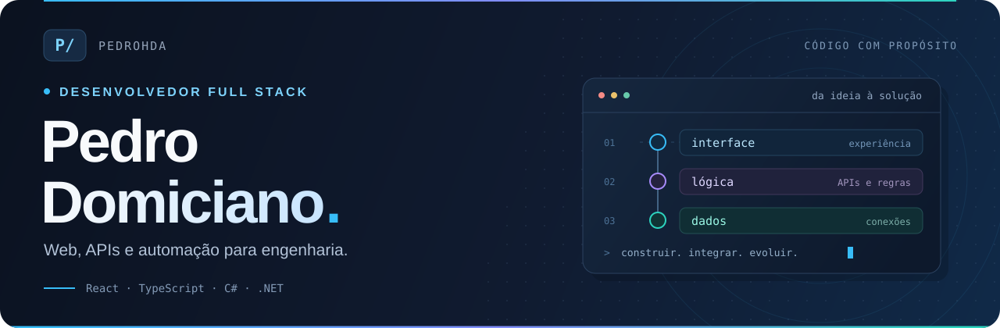
  </picture>

  <strong>Código que conecta ideias ao mundo real.</strong> 
  📍 São José dos Campos, SP · 🎓 Engenharia da Computação / UNIVAP · 💻 Mult-e

  
  
  

<h2 align="center">⚡ Tecnologias</h2>

<strong>Front-end</strong>

  
  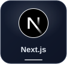
  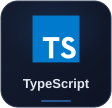
  
  
  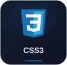

<strong>Back-end &amp; apps</strong>

  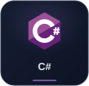
  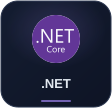
  
  
  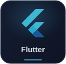
  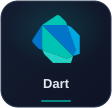

<strong>Dados &amp; ferramentas</strong>

  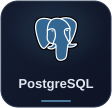
  
  
  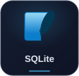
  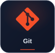

<h2 align="center">🚀 Projetos em destaque</h2>

  <a href="https://github.com/PedroHda/CarrinhoDeCompras">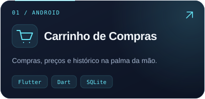</a>
  <a href="https://github.com/PedroHda/MDReader">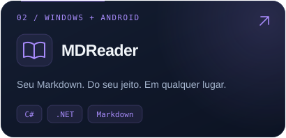</a>

  <a href="https://github.com/PedroHda/Financeiro">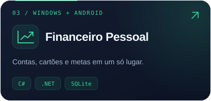</a>
  <a href="https://pedrodomiciano.netlify.app">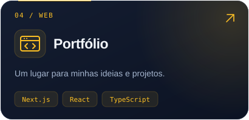</a>

  <a href="https://github.com/PedroHda/ProjetoVan">🚌 RotaCerta Escolar</a> &nbsp; · &nbsp;
  <a href="https://github.com/PedroHda/NossoCasamento">💍 Nosso Casamento</a> &nbsp; · &nbsp;
  <a href="https://github.com/PedroHda?tab=repositories"><strong>Todos os projetos ↗</strong></a>

<h2 align="center">📈 GitHub em movimento</h2>

  
  

  <strong>Vamos tirar uma ideia do papel?</strong> 
  <a href="mailto:pedroh.domic@gmail.com">pedroh.domic@gmail.com</a> 
  <a href="https://www.instagram.com/pedro_domiciano/">Instagram</a> · <a href="https://www.facebook.com/pedro.domiciano.7/">Facebook</a>

